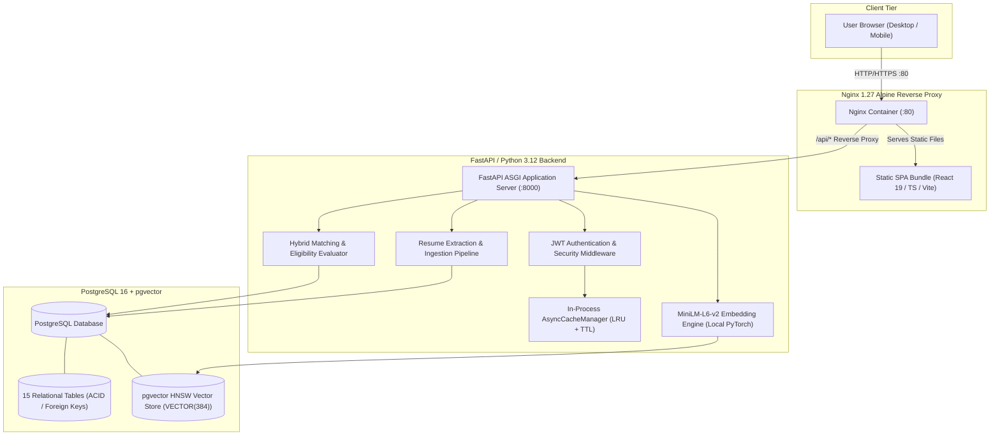
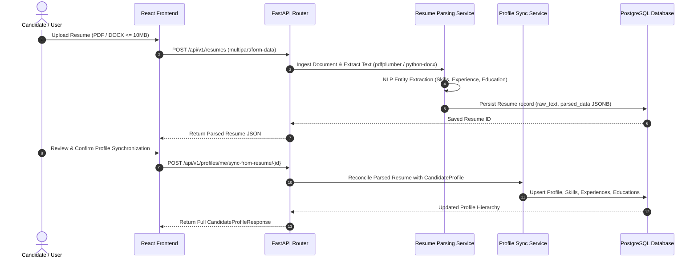
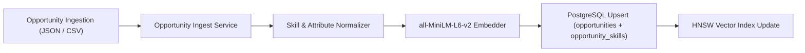
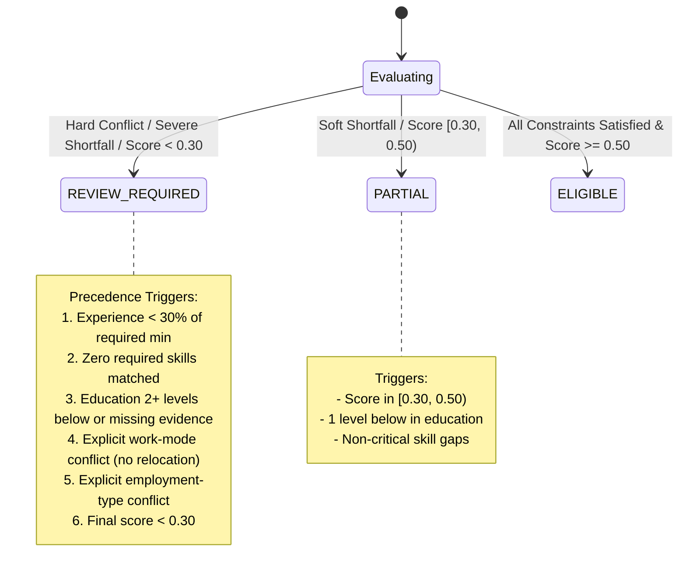
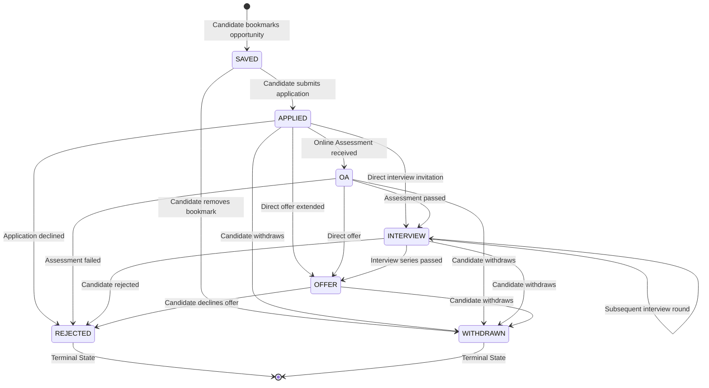

# CareerLens — System Architecture Specification (v1.1)

## 1. Executive Summary & System Purpose

**CareerLens** is an intelligent, privacy-first career navigation and application tracking platform designed to bridge the gap between candidate qualifications and career opportunities. Rather than relying on opaque black-box ranking or superficial keyword filtering, CareerLens combines:

1. **Deterministic Local NLP Parsing**: Structured extraction of candidate credentials, skills, work history, and education from PDF/DOCX resumes.
2. **Dense Semantic Retrieval**: High-dimensional vector embeddings generated locally via `sentence-transformers/all-MiniLM-L6-v2` (384 dimensions) and indexed natively in PostgreSQL via `pgvector` HNSW indexes.
3. **Transparent Hybrid Matching Engine**: A multi-factor scoring algorithm integrating semantic text similarity (35%) with deterministic constraint evaluations (65%) across skill overlap, experience depth, academic hierarchy, location compatibility, work-mode preference, and employment-type alignment.
4. **Actionable Explainability & Skill Gap Diagnostics**: Automated generation of human-readable strengths, missing qualifications, and concrete skill gaps for every candidate-opportunity pairing.
5. **Audited Application Tracking**: An immutable state machine and audit log tracking candidate applications from discovery through terminal disposition.

---

## 2. High-Level System Topology

CareerLens is architected as a cohesive **Modular Monolith** with containerized deployment topology:



---

## 3. Component Architecture Breakdown

### 3.1. Frontend Architecture
- **Framework**: React 19 with TypeScript.
- **Tooling**: Vite for fast ESM builds and Hot Module Replacement.
- **Styling**: Tailwind CSS v4 design system with glassmorphic cards, responsive layouts, and accessible color contrasts.
- **State & Routing**: `react-router-dom` client-side routing with protected route boundaries (`ProtectedRoute`) that verify JWT authentication state before rendering candidate dashboard views.
- **HTTP Client**: Axios with interceptors automatically attaching `Authorization: Bearer <token>` and handling token expiration / 401 redirects.

### 3.2. Backend Architecture
- **Framework**: FastAPI (Python 3.12) running under Uvicorn ASGI server.
- **Structure**: Modular domains organized under `app/api/v1/endpoints/`, `app/services/`, `app/models/`, `app/schemas/`, and `app/core/`.
- **Dependency Injection**: FastAPI `Depends` handles async database session lifecycle (`get_db`) and user authentication / profile resolution (`get_current_user`, `get_current_candidate_profile`).
- **Data Validation**: Pydantic v2 schemas providing strict compile-time and runtime validation, type coercion, and auto-generated OpenAPI 3.1 documentation.

### 3.3. Database & pgvector Architecture
- **Engine**: PostgreSQL 16 LTS (development also verified on PostgreSQL 18.x).
- **Extension**: `pgvector` enabling native `VECTOR(384)` storage and cosine distance calculations (`<=>`).
- **ORM / Driver**: SQLAlchemy 2.0 (asyncio mode) paired with the high-performance `asyncpg` driver.
- **Migrations**: Alembic manages schema versioning with deterministic sequential revisions.
- **Index Optimization**:
  - HNSW (Hierarchical Navigable Small World) index on `opportunities.embedding` for fast approximate nearest neighbor (ANN) retrieval:
    ```sql
    CREATE INDEX idx_opportunities_embedding_hnsw 
    ON opportunities USING hnsw (embedding vector_cosine_ops) 
    WITH (m = 16, ef_construction = 64);
    ```
  - Composite B-tree indexes on `(candidate_profile_id, final_score DESC)` on `matches` and `(candidate_profile_id, status)` on `applications`.

---

## 4. End-to-End Workflows

### 4.1. Candidate Registration, Profile & Resume Synchronization



1. **Document Validation**: Files are strictly validated for MIME type (`application/pdf`, `application/vnd.openxmlformats-officedocument.wordprocessingml.document`) and maximum file size (10 MB).
2. **Text & Structure Extraction**:
   - PDF extraction uses `pdfplumber` to extract clean textual content, preserving structural layout and multi-column ordering.
   - DOCX extraction uses `python-docx` to iterate through paragraphs and structured table cells.
3. **Information Extraction**:
   - Skills are matched against an extensive taxonomy of canonical technical and domain skills, normalizing aliases (e.g., `Postgres` -> `PostgreSQL`, `React.js` -> `React`).
   - Dates and employment intervals are parsed with fuzzy date regexes and ISO normalization.
   - Academic degrees are mapped to standardized `EducationLevel` enums (`NONE`, `DIPLOMA`, `BACHELOR`, `MASTER`, `PHD`).
4. **Interactive Synchronization**: Extracted entities are returned to the candidate for review. When the candidate triggers synchronization, `ProfileSyncService` merges records without overwriting manually edited candidate data unless explicitly requested.

---

### 4.2. Opportunity Ingestion & Normalization



1. **Payload Ingestion**: Opportunities are ingested via `/api/v1/opportunities/ingest` supporting JSON arrays or CSV uploads.
2. **Attribute Normalization**:
   - Work mode mapped to `WorkMode` enum (`ONSITE`, `HYBRID`, `REMOTE`, `ANY`).
   - Employment type mapped to `EmploymentType` enum (`FULL_TIME`, `PART_TIME`, `CONTRACT`, `INTERNSHIP`, `ANY`).
   - Education requirements normalized to `EducationLevel` enum.
   - Skill requirements separated into `is_required=True` (mandatory) and `is_required=False` (preferred).
3. **Embedding Generation**: Text representation combining title, company, description, and skill requirements is embedded using local `SentenceTransformer("all-MiniLM-L6-v2")` into a 384-dimensional dense float vector.
4. **Deduplication**: Ingestion checks existing opportunities by `(source, source_id)` or canonical title and company name to prevent duplicate entries.

---

### 4.3. Semantic Retrieval & Hybrid Matching Engine

The hybrid matching algorithm evaluates candidates against opportunities across seven distinct dimensions, totaling a normalized composite score of `1.00`:

$$\text{Final Score} = 0.35 \cdot S_{\text{semantic}} + 0.25 \cdot S_{\text{skill}} + 0.15 \cdot S_{\text{experience}} + 0.10 \cdot S_{\text{education}} + 0.05 \cdot S_{\text{location}} + 0.05 \cdot S_{\text{work\_mode}} + 0.05 \cdot S_{\text{employment\_type}}$$

```
┌────────────────────────────────────────────────────────────────────────┐
│                        Hybrid Scoring Weights                          │
├────────────────────────────────┬────────┬──────────────────────────────┤
│ Factor                         │ Weight │ Scoring Mechanism            │
├────────────────────────────────┼────────┼──────────────────────────────┤
│ Semantic Similarity            │  0.35  │ max(0.0, Cosine Similarity)  │
│ Skill Overlap                  │  0.25  │ 0.70 * ReqRatio + 0.30 * Pref│
│ Experience Depth               │  0.15  │ Merged non-overlapping years │
│ Education Hierarchy            │  0.10  │ Academic degree order ladder │
│ Location Compatibility         │  0.05  │ Exact / Relocation tolerance │
│ Work Mode Preference           │  0.05  │ Remote / Hybrid / Onsite fit │
│ Employment Type Alignment      │  0.05  │ Full-time / Contract / Any   │
├────────────────────────────────┼────────┼──────────────────────────────┤
│ Total Weight Sum               │  1.00  │ Normalized Range: [0.0, 1.0] │
└────────────────────────────────┴────────┴──────────────────────────────┘
```

#### Detailed Dimension Mechanics:
1. **Semantic Similarity ($S_{\text{semantic}}$)**:
   - Raw cosine similarity computed between candidate profile summary embedding and opportunity embedding.
   - Normalization formula: $\max(0.0, \text{cosine\_similarity})$. Negative cosine values are floored at 0.0.
2. **Skill Overlap ($S_{\text{skill}}$)**:
   - Evaluates matched vs missing skills across required and preferred tiers:
     - Both required and preferred specified: $\text{Score} = 0.70 \cdot \frac{|\text{Matched Req}|}{|\text{Req}|} + 0.30 \cdot \frac{|\text{Matched Pref}|}{|\text{Pref}|}$
     - Only required specified: $\text{Score} = \frac{|\text{Matched Req}|}{|\text{Req}|}$
     - Neither specified: $\text{Score} = 1.00$
3. **Experience Depth ($S_{\text{experience}}$)**:
   - Computes total non-overlapping work duration in fractional years by merging overlapping employment date intervals.
   - If candidate years $\ge \text{min}$: $\text{Score} = 1.00$. If $\text{candidate years} > \text{max}$, applies soft overqualification penalty: $\max(0.60, 1.0 - 0.05 \cdot (\text{years} - \text{max}))$. Overqualification never disqualifies.
   - If candidate years $< \text{min}$: proportional score $\frac{\text{candidate years}}{\text{min}}$.
4. **Education Level ($S_{\text{education}}$)**:
   - Strict hierarchical order: $\text{NONE} (0) < \text{DIPLOMA} (1) < \text{BACHELOR} (2) < \text{MASTER} (3) < \text{PHD} (4)$.
   - Meets or exceeds: $1.00$.
   - One tier below requirement: $0.50$ (with warning).
   - Two or more tiers below: $0.20$ (triggers review).
   - Missing education credentials for a degree-required role: neutral $0.50$ with `missing_evidence` flag (triggers manual review, not automatic rejection).
5. **Location Compatibility ($S_{\text{location}}$)**:
   - Remote opportunity or exact city match: $1.00$.
   - Mismatch with `open_to_relocation=True`: $0.70$.
   - Mismatch with `open_to_relocation=False`: $0.00$.
6. **Work Mode Compatibility ($S_{\text{work\_mode}}$)**:
   - Opportunity is `ANY` or candidate prefers `ANY`: $1.00$.
   - Exact match: $1.00$.
   - Remote opportunity for onsite/hybrid candidate: soft fit $0.80$.
   - Onsite opportunity for remote candidate: $0.60$ if open to relocation, $0.00$ with explicit conflict if not open to relocation.
7. **Employment Type Compatibility ($S_{\text{employment\_type}}$)**:
   - Exact match or either side is `ANY`: $1.00$.
   - Unspecified candidate preference: neutral $0.50$.
   - Direct conflict: $0.00$.

---

### 4.4. Eligibility Status Evaluation & Precedence Rules

The engine evaluates constraints to classify each match into one of three statuses:



- **REVIEW_REQUIRED**: Preempts all other statuses if any hard constraint trigger fires or composite score is $< 0.30$.
- **PARTIAL**: Applied when soft mismatches exist and composite score is in $[0.30, 0.50)$.
- **ELIGIBLE**: Granted when all constraints are met and composite score is $\ge 0.50$.
- **Missing Information Policy**: Unspecified candidate preferences (e.g., location, employment type) receive neutral baseline scores ($0.50$) and generate transparent warnings. Candidates are **never** disqualified solely due to missing non-mandatory profile fields.

---

### 4.5. Application Tracking Lifecycle & State Machine

CareerLens enforces a strict application status state machine defined in `app/models/enums.py` and `app/services/application_service.py`:



#### State Transition Rules:
- **Terminal States**: `REJECTED` and `WITHDRAWN` are terminal; no further status transitions are permitted once entered.
- **Audit Logging**: Every successful status transition automatically writes an immutable entry to `application_status_history` recording `from_status`, `to_status`, `changed_at`, and optional candidate notes.
- **Uniqueness**: A unique constraint on `(candidate_profile_id, opportunity_id)` prevents accidental duplicate applications to the same opportunity.

---

## 5. Security & Isolation Architecture

1. **Authentication & Password Hashing**:
   - Passwords hashed using `bcrypt` via Passlib with automated salting.
   - Sessions authenticated using standard JWT Bearer tokens signed with HMAC-SHA256 (`HS256`).
   - Access tokens have configurable expiration (`ACCESS_TOKEN_EXPIRE_MINUTES`, default 1440 min = 24 hours).
2. **Candidate Ownership Checks**:
   - All profile sub-resources (`skills`, `experiences`, `educations`, `projects`, `certifications`), resumes, match evaluations, and applications strictly verify that the querying user owns the candidate profile (`profile.user_id == current_user.id`).
   - Cross-user modifications or inspections return HTTP 403 Forbidden or HTTP 404 Not Found.
3. **Database Least-Privilege Role**:
   - The application database user (`careerlens_user`) operates under strict least privilege:
     - `rolcanlogin = TRUE`
     - `rolcreatedb = FALSE`
     - `rolsuper = FALSE`
     - `rolcreaterole = FALSE`
   - Database and schema ownership are granted to `careerlens_user` for running Alembic migrations, while cluster-level administration remains isolated to superuser `postgres`.
4. **Defensive HTTP Headers & Secret Protection**:
   - HTTP response headers: `X-Content-Type-Options: nosniff`, `X-Frame-Options: DENY`, `X-XSS-Protection: 1; mode=block`, `Referrer-Policy: strict-origin-when-cross-origin`.
   - Sensitive log redaction: `SensitiveDataFilter` masks credentials, passwords, JWT tokens, and connection strings from application log outputs.
   - Production validation: Startup guards abort initialization if `DEBUG=true`, `JWT_SECRET_KEY` length $< 32$ characters, or wildcard `CORS_ORIGINS=*` are detected in production mode.

---

## 6. Caching Architecture & Single-Worker Constraint

CareerLens incorporates an in-process, asynchronous LRU caching engine (`AsyncCacheManager`) defined in `app/core/cache.py`:

- **Capacity & Expiration**: 5,000 maximum entries with a default TTL of 120.0 seconds using monotonic clock time (`time.monotonic()`).
- **Deterministic Namespacing**: Composite cache keys strictly partition cached entries by candidate `profile_id` and SHA-256 query parameter digests:
  - Opportunities: `opp:list:{hash}`, `opp:detail:{id}`
  - Recommendations: `recom:{profile_id}:{hash}`
  - Matches: `matches:list:{profile_id}:{hash}`, `match:single:{profile_id}:{id}`
  - Applications: `apps:list:{profile_id}:{hash}`
- **Transparent Invalidation**: Updates to opportunities, profiles, matches, or application status automatically evict matching prefix tags.
- **Architectural Limitation — Single-Worker Assumption**:
  > [!IMPORTANT]
  > Because the cache is in-process (`OrderedDict` guarded by `asyncio.Lock`), cache state is local to each Python process. The current deployment architecture specifies a single Uvicorn worker per backend container. If multi-worker scaling or clustered replicas are introduced in the future, the cache must be migrated to an external distributed cache (e.g., Redis or KeyDB) to guarantee cluster-wide cache invalidation.

---

## 7. Containerization & Deployment Architecture

CareerLens is packaged using Docker and orchestrated via Docker Compose:

```
┌────────────────────────────────────────────────────────────────────────┐
│                        Docker Compose Topology                         │
├───────────────────┬────────────────────────────────────────────────────┤
│ Container Service │ Image / Specification                              │
├───────────────────┼────────────────────────────────────────────────────┤
│ db                │ pgvector/pgvector:pg16 (Healthcheck: pg_isready)   │
│ migration         │ Custom backend image running alembic upgrade head  │
│ backend           │ Custom Python 3.12 slim, non-root user (UID 10001) │
│ frontend          │ Custom Node 20 build -> Nginx 1.27 Alpine runtime  │
└───────────────────┴────────────────────────────────────────────────────┘
```

- **Pre-cached Embeddings**: The backend Docker image pre-downloads and packages the `all-MiniLM-L6-v2` model during build time into `/root/.cache/huggingface`, ensuring the container starts instantly offline without network dependencies.
- **Migration Dependency**: The `backend` service depends on `migration: service_completed_successfully`, ensuring the database schema is fully up-to-date before API traffic begins.
- **Reverse Proxy Routing**:
  - `/` -> Serves React SPA static assets (`index.html` fallback for client-side routing).
  - `/api/` -> Reverse-proxied to `http://backend:8000/api/`.
  - `/docs`, `/redoc`, `/openapi.json`, `/health` -> Reverse-proxied to backend.

---

## 8. Implemented vs. Planned Architectural Boundaries

To preserve strict academic honesty and clear engineering boundaries, the platform distinguishes between completed components and mandatory future phases:

### Implemented Architecture (Phases 1–25):
- [x] Candidate authentication, profile lifecycle, and sub-entity CRUD.
- [x] Local PDF/DOCX resume text extraction and skill/credential normalization.
- [x] Opportunity batch ingestion (CSV/JSON), skill requirement tagging, and pgvector embeddings.
- [x] Dense semantic retrieval via HNSW vector indexing.
- [x] Transparent 7-factor hybrid matching engine with deterministic eligibility rules and skill-gap diagnostics.
- [x] Opportunity exploration, recommendation frontend, and interactive match evaluations.
- [x] Complete candidate application tracking state machine and status transition audit history.
- [x] In-process LRU caching, least-privilege PostgreSQL role configuration, and Docker Compose deployment.

### Scheduled Future Roadmap (Horizon 4 — Mandatory Core Capabilities):
- [ ] **Phase 26: Multi-Platform Opportunity Collection & Resilient Web Scraping**:
  - Integration with external job boards, internship portals, hackathon platforms (Devpost), and competitive programming contests (Codeforces, LeetCode).
  - Source-specific scrapers using BeautifulSoup and Playwright with rate-limiting, exponential backoff, robots.txt compliance, and automated background refresh.
- [ ] **Phase 27: Automated External Application Form Filling & User-Confirmed Submission**:
  - Browser extension / automation agent detecting standard ATS form fields (Workday, Greenhouse, Lever).
  - Pre-filling verified candidate profile and resume data into form inputs.
  - Mandatory user preview and explicit confirmation modal prior to external form submission.
  - Automated receipt detection and automatic application status transition from `SAVED` to `APPLIED`.
