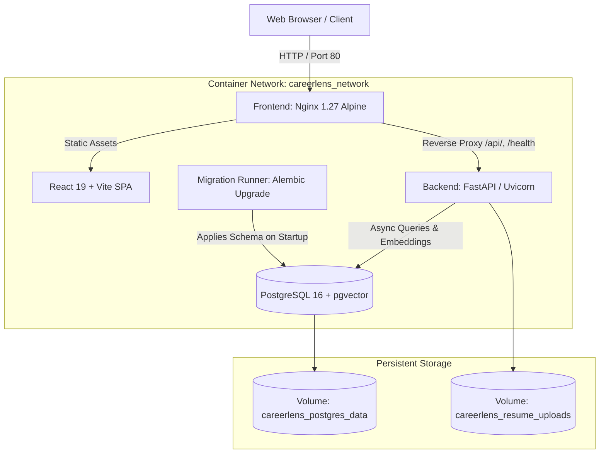

# CareerLens — Deployment, Containerization, and Operations Guide

This guide provides operational and deployment documentation for CareerLens. It details multi-container Docker orchestration, environment configuration, database lifecycle with pgvector, migration management, in-memory caching characteristics, and troubleshooting procedures.

---

## 1. Container Architecture and Topology

CareerLens uses a decoupled micro-service container architecture managed via Docker Compose (`docker-compose.yml` / `compose.yaml`).



### Container Services

| Service Name | Base Image | Role | User / Security | Ports (Host:Container) |
|---|---|---|---|---|
| **`db`** | `pgvector/pgvector:pg16` | Relational store and dense vector similarity engine | `postgres` | `127.0.0.1:5432:5432` (Loopback only) |
| **`migration`** | Custom (`backend/Dockerfile`) | One-off Alembic database migration executor | `careerlens` (UID 10001) | None |
| **`backend`** | Custom (`backend/Dockerfile`) | FastAPI REST API and SentenceTransformers engine | `careerlens` (UID 10001) | `127.0.0.1:8000:8000` (Loopback only) |
| **`frontend`** | Custom (`frontend/Dockerfile`) | Production Nginx web server and API reverse proxy | `nginx` | `80:80` (or `${FRONTEND_PORT}`) |

---

## 2. Security Design and Hardening

1. **Non-Root Execution**:
   - The backend container builds using a dedicated unprivileged user (`careerlens`, UID `10001`, GID `10001`).
   - Writable directories are strictly constrained to `/app/data/uploads/resumes` and `/app/.cache/huggingface`.
2. **Local Loopback Port Binding**:
   - Database port (`5432`) and backend port (`8000`) bind to `127.0.0.1` by default rather than `0.0.0.0`, preventing direct external network exposure.
   - External traffic enters exclusively through the frontend Nginx reverse proxy on port `80`.
3. **Production Configuration Validation**:
   - Backend startup validates that `DEBUG=false` when `ENVIRONMENT=production`.
   - `JWT_SECRET_KEY` is enforced to be at least 32 characters in production.
   - Default placeholder database credentials (`PASSWORD@`) are blocked at startup.
   - Wildcard CORS origins (`*`) are prohibited in production.
4. **Offline Local Embeddings**:
   - The SentenceTransformers model (`sentence-transformers/all-MiniLM-L6-v2`) is pre-cached during the Docker build stage into `/app/.cache/huggingface`.
   - The backend runs fully offline without requiring egress connectivity to Hugging Face Hub during boot or inference.

---

## 3. Environment Configuration (`.env`)

Copy `.env.example` to `.env` in the project root:

```bash
cp .env.example .env
```

### Variable Reference

| Variable | Requirement | Default | Description |
|---|---|---|---|
| `APP_ENV` | Optional | `production` | Active environment (`production`, `development`, `test`). |
| `APP_DEBUG` | Optional | `false` | Enable/disable debug mode (must be `false` in prod). |
| `POSTGRES_USER` | Operator | `careerlens_user` | PostgreSQL database username. |
| `POSTGRES_PASSWORD` | **Required** | None | Strong password for PostgreSQL database. |
| `POSTGRES_DB` | Operator | `careerlens_db` | Primary database name. |
| `POSTGRES_PORT` | Optional | `5432` | Host port for database (bound to `127.0.0.1`). |
| `JWT_SECRET_KEY` | **Required** | None | Secret key for JWT tokens (**>= 32 chars in prod**). |
| `FRONTEND_PORT` | Optional | `80` | Host port for web application traffic. |
| `CORS_ORIGINS` | Optional | `http://localhost,http://127.0.0.1` | Allowed browser origins (comma-separated). |
| `EMBEDDING_PROVIDER` | Optional | `local` | `local` (CPU MiniLM) or `openai`. |
| `LLM_PROVIDER` | Optional | `none` | `none`, `gemini`, or `openai` (`none` uses fallbacks). |

> [!IMPORTANT]
> Never commit `.env` or production secrets to Git. `.env` is covered by root `.gitignore`.

---

## 4. Controlled Database Migration Strategy

Database migrations are executed via a **dedicated single-run container** (`migration`) rather than inside long-running application workers:

1. **Why Controlled Migrations?**
   - Running migrations inside application worker startup causes race conditions and deadlock when multiple backend workers boot concurrently.
   - The `migration` service runs `alembic upgrade head` once against `db` after `db` reports `service_healthy`.
   - The `backend` service starts only after `migration` completes with `service_completed_successfully`.
2. **Manual Migration Execution**:
   To run migrations manually outside of Compose startup:
   ```bash
   docker compose run --rm migration alembic upgrade head
   ```
3. **Rollback Migration**:
   ```bash
   docker compose run --rm migration alembic downgrade -1
   ```

---

## 5. First-Time Startup and Operational Lifecycle

### Step 1: Clean Checkout Setup
```bash
git clone https://github.com/Mastermindmani88897/CAREERLENS.git
cd CAREERLENS
cp .env.example .env
# Edit .env and set strong POSTGRES_PASSWORD and JWT_SECRET_KEY (>= 32 characters)
```

### Step 2: Build and Launch Stack
```bash
docker compose up --build -d
```

### Step 3: Verify Container Health
```bash
docker compose ps
```
Expected output:
- `careerlens-db`: `Up (healthy)`
- `careerlens-migration`: `Exited (0)`
- `careerlens-backend`: `Up (healthy)`
- `careerlens-frontend`: `Up (healthy)`

### Step 4: Verify Health Endpoints
```bash
# Service health probe
curl http://localhost/health

# Database and pgvector extension verification
curl http://localhost/health/db
```
Expected response:
```json
{
  "status": "ok",
  "app": "CareerLens",
  "version": "0.5.0",
  "database": "postgresql",
  "pgvector_installed": true,
  "pgvector_version": "0.8.0",
  "pgvector_operational": true
}
```

### Step 5: Graceful Shutdown and Restart
```bash
# Graceful stop
docker compose down

# Restart without rebuilding
docker compose up -d

# Complete reset (WARNING: wipes database volume)
docker compose down -v
```

---

## 6. Database Backup, Restore, and Persistence

PostgreSQL data is stored in Docker volume `careerlens_postgres_data` and persists across container rebuilds.

### Backup (Dump)
```bash
docker compose exec -T db pg_dump -U careerlens_user -d careerlens_db -F c > careerlens_backup_$(date +%Y%m%d_%H%M%S).dump
```

### Restore
```bash
# Terminate existing connections and recreate database if necessary
docker compose exec -T db dropdb -U careerlens_user --if-exists careerlens_db
docker compose exec -T db createdb -U careerlens_user -O careerlens_user careerlens_db

# Restore from dump file
cat careerlens_backup.dump | docker compose exec -T db pg_restore -U careerlens_user -d careerlens_db --no-owner --role=careerlens_user
```

---

## 7. In-Memory Caching Architecture and Worker Limitations

CareerLens includes an asynchronous in-memory caching engine (`backend/app/core/cache.py`):

1. **Process-Local Scope**:
   - The cache lives in the memory space of each Python process.
   - In single-replica / single-worker configurations (the standard production deployment), the cache delivers sub-10 microsecond response times with zero network overhead.
2. **Multi-Worker Concurrency Characteristics**:
   - If multiple backend workers or containers are scaled horizontally, **each worker maintains an independent in-memory cache**.
   - **Cross-worker cache coherence is not shared**: When Worker A receives a mutation (e.g. application creation) and invalidates its local cache, Worker B will serve its cached copy until the item's TTL expires (60s to 300s).
   - All cached data is strictly partitioned by `candidate_profile_id` and query hashes, guaranteeing **zero multi-user data leakage** regardless of worker topology.
   - For high-concurrency clustered horizontal scaling requiring instantaneous cross-node invalidation, a distributed Redis backend can be connected via the abstract `AsyncCacheManager` interface.

---

## 8. Troubleshooting Guide

| Issue | Likely Cause | Remediation |
|---|---|---|
| **Database connection refused** | `db` container still initializing or unhealthy. | Check `docker compose logs db`. Ensure PostgreSQL healthcheck passes before backend starts. |
| **Migration failure on startup** | Incompatible schema revision or missing `vector` extension. | Check `docker compose logs migration`. Ensure `docker/postgres/init-pgvector.sql` initialized the extension. |
| **`JWT_SECRET_KEY` validation error** | Secret key shorter than 32 characters in production. | Update `JWT_SECRET_KEY` in `.env` to at least 32 characters (e.g. generated via `openssl rand -hex 32`). |
| **Port 80 conflict on host** | Host web server (IIS, Apache, Nginx) already listening on port 80. | Change `FRONTEND_PORT=8080` or `3000` in `.env` and rebuild via `docker compose up -d`. |
| **Permission denied on uploads** | Volume permissions conflict. | Backend runs as UID 10001. Ensure `resume_uploads` volume is owned by UID 10001 or let Docker initialize it. |
| **CORS errors in browser** | Frontend origin missing from `CORS_ORIGINS`. | Add host IP/domain to `CORS_ORIGINS` in `.env` and restart backend. |
