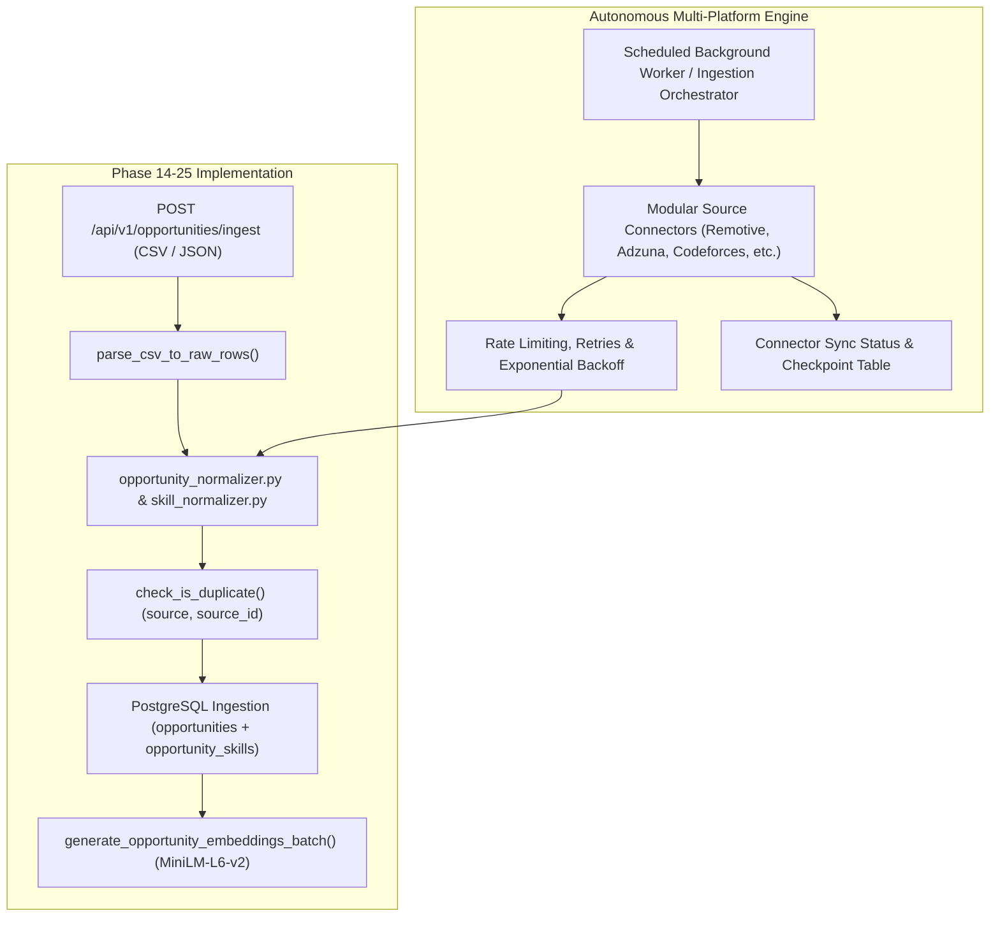
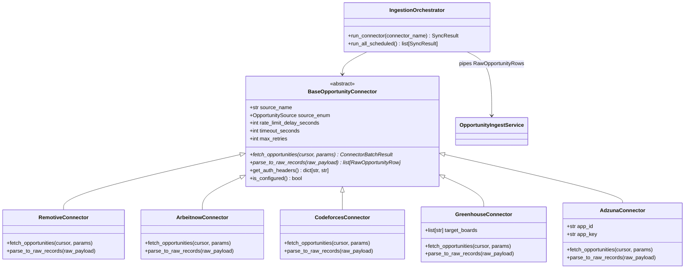

# CareerLens — Phase 26.1: Multi-Platform Opportunity Collection Architecture & Audit Plan

## 1. Executive Summary & Objective

**CareerLens Phase 26** is a mandatory core milestone dedicated to transforming CareerLens from an internal opportunity repository (relying on manual CSV/JSON uploads) into an **autonomous, multi-platform opportunity intelligence engine**. 

The platform must continuously aggregate, normalize, embed, and categorize opportunities across four core domains:
1. **Full-time & Part-time Jobs**
2. **Internships**
3. **Hackathons & Innovation Competitions**
4. **Competitive Programming & Coding Contests**

### Phase 26.1 Boundary:
This document establishes the **architectural blueprint, legal compliance review, source inventory audit, and schema evolution plan** for Phase 26. In accordance with project governance:
- **No live scraping or unapproved data collection is performed during this audit.**
- **No external application form automation (Phase 27) is implemented.**
- **No APIs or credentials are fabricated.** Sources without verified public access are explicitly designated as `REQUIRES APPROVAL` or `UNSUPPORTED`.
- Existing batch ingestion, normalizers, and pgvector embedding pipelines are reused rather than replaced.

---

## 2. Current-State Audit Findings

An exhaustive audit of the existing repository reveals the following ingestion foundation and architectural gaps:



### 2.1. Existing Assets Reusable for Phase 26
1. **`OpportunityIngestService` (`app/services/opportunity_ingest_service.py`)**:
   - Implements high-throughput transactional record persistence using SQLAlchemy async savepoints (`begin_nested`).
   - Implements two-tier deduplication: primary check on `(source, source_id)` and fallback check on `(company, title, job_url)` or `(company, title, location)`.
   - Automatically dispatches post-commit batch embedding generation (`generate_opportunity_embeddings_batch`).
2. **`OpportunityNormalizer` (`app/services/opportunity_normalizer.py`)**:
   - Clean, deterministic text sanitization (stripping control characters while preserving proper casing).
   - URL canonicalization: stripping tracking parameters (`utm_*`, `gclid`, `fbclid`, `ref`) while preserving functional identifiers.
   - Robust date parsing across international formats (`YYYY-MM-DD`, `DD/MM/YYYY`, `MM/DD/YYYY`).
   - Enum resolvers for `WorkMode`, `EmploymentType`, and `EducationLevel`.
3. **`OpportunitySkillNormalizer` (`app/services/opportunity_skill_normalizer.py`)**:
   - Separates skills into `required` vs `preferred` tiers.
   - Normalizes alias tokens (e.g., `Postgres` $\to$ `PostgreSQL`, `ReactJS` $\to$ `React`).
4. **HNSW Vector Storage**:
   - Native `pgvector` indexing on `opportunities.job_embedding` (`VECTOR(384)`) supporting instant nearest-neighbor similarity querying via cosine distance (`<=>`).

### 2.2. Discovered Schema Gaps & Architectural Deficiencies
1. **`OpportunityType` Enum Incomplete**:
   - Current enum (`app/models/enums.py`): `JOB = "job"`, `INTERNSHIP = "internship"`, `HACKATHON = "hackathon"`.
   - **Missing**: `CODING_CONTEST = "coding_contest"` (or `CONTEST = "contest"`). Programming competitions cannot currently be distinguished from jobs or hackathons without overloading enum fields.
2. **`OpportunitySource` Enum Restrictive**:
   - Current enum: `SYNTHETIC = "synthetic"`, `MANUAL = "manual"`, `API = "api"`.
   - Storing live sources like `adzuna`, `remotive`, `arbeitnow`, `codeforces`, `greenhouse`, `lever` under generic `api` destroys source attribution, prevents source-specific deduplication, and makes source-filtered refresh impossible.
   - **Requirement**: `OpportunitySource` must either be expanded to include specific platform sources or transitioned to a flexible string identifier backed by a `sources` reference registry.
3. **Missing Contest & Hackathon Attributes**:
   - The current `Opportunity` table lacks event-specific temporal and incentive fields:
     - Event start and end timestamps (`event_start_time`, `event_end_time` or `duration_seconds`).
     - Registration deadline (distinct from employment application deadline).
     - Prize pool, stipend, or awards summary (`prize_description` or `reward_amount`).
     - Organization / Host platform attribution (e.g., contest platform vs sponsoring company).
4. **No Automated Ingestion Scheduling or Checkpointing**:
   - The existing system has zero scheduler infrastructure: opportunities can only be created via synchronous HTTP POST to `/api/v1/opportunities/ingest`.
   - No tracking table exists to record when a source was last polled, cursor pagination states, records fetched, failures encountered, or rate limit backoff timers.

---

## 3. Comprehensive Source Inventory & Feasibility Audit

To establish an authoritative baseline, 22 candidate platforms across employment, internships, hackathons, and programming contests were audited against their published terms of service, developer portals, robots policies, and API availability.

```
┌────────────────────────────────────────────────────────────────────────────────────────────────────────┐
│                                   Source Feasibility Summary Matrix                                    │
├───────────────────┬──────────────┬───────────────────┬────────────────────┬───────────┬────────────────┤
│ Source Name       │ Category     │ Ingestion Method  │ Auth / Credentials │ Feasibility│ Priority       │
├───────────────────┼──────────────┼───────────────────┼────────────────────┼───────────┼────────────────┤
│ Remotive          │ Jobs/Intern  │ Official JSON API │ None (Public)      │ APPROVED  │ Wave 1 (P1)    │
│ Arbeitnow         │ Jobs/Intern  │ Official JSON API │ None (Public)      │ APPROVED  │ Wave 1 (P1)    │
│ Codeforces        │ Contests     │ Official REST API │ None (Public)      │ APPROVED  │ Wave 1 (P1)    │
│ Greenhouse Boards │ Jobs/Intern  │ Official JSON API │ None (Per-Board)   │ APPROVED  │ Wave 1 (P1)    │
│ Adzuna            │ Jobs/Intern  │ Official REST API │ App ID + App Key   │ APPROVED  │ Wave 2 (P2)    │
│ USAJOBS           │ Jobs/Intern  │ Official REST API │ API Key + Email    │ APPROVED  │ Wave 2 (P2)    │
│ Lever Postings    │ Jobs/Intern  │ Official JSON API │ None (Per-Company) │ APPROVED  │ Wave 2 (P2)    │
│ Remote OK         │ Remote Jobs  │ Public JSON Feed  │ None (Attribution) │ APPROVED  │ Wave 2 (P2)    │
│ Devpost           │ Hackathons   │ Permitted RSS/HTML│ None (HTML Parser) │ CONDITIONAL│ Wave 3 (P3)    │
│ MLH (Major League)│ Hackathons   │ Permitted RSS/HTML│ None (HTML Parser) │ CONDITIONAL│ Wave 3 (P3)    │
│ AtCoder           │ Contests     │ Unofficial API    │ None (Public)      │ CONDITIONAL│ Wave 3 (P3)    │
│ LeetCode Contests │ Contests     │ GraphQL Endpoint  │ None (Public GQL)  │ CONDITIONAL│ Wave 3 (P3)    │
│ HackerEarth       │ Contests/Hck │ Partner API / HTML│ Requires Approval  │ GATED     │ Post-Phase 26  │
│ Unstop            │ Hack/Contest │ Scraper Required  │ Requires Approval  │ GATED     │ Post-Phase 26  │
│ Internshala       │ Internships  │ Scraper Required  │ Prohibited by ToS  │ RESTRICTED│ Unsupported    │
│ LinkedIn          │ Jobs/Intern  │ Enterprise API    │ Partner Agreement  │ RESTRICTED│ Unsupported    │
│ Indeed            │ Jobs         │ Partner API       │ Partner Agreement  │ RESTRICTED│ Unsupported    │
│ Glassdoor         │ Jobs         │ Enterprise API    │ Enterprise License │ RESTRICTED│ Unsupported    │
│ Wellfound         │ Startup Jobs │ Cloudflare Gated  │ Prohibited by ToS  │ RESTRICTED│ Unsupported    │
│ Naukri            │ Jobs         │ Recruiter API     │ Enterprise Only    │ RESTRICTED│ Unsupported    │
│ Workday           │ Enterprise   │ Tenant Proprietary│ Variable Tenant    │ GATED     │ Enterprise Ext │
│ CodeChef          │ Contests     │ OAuth2 Partner API│ Requires Approval  │ GATED     │ Post-Phase 26  │
└───────────────────┴──────────────┴───────────────────┴────────────────────┴───────────┴────────────────┘
```

---

### 3.1. Detailed Platform Analysis

#### 1. Remotive (`https://remotive.com/api/remote-jobs`)
- **Category**: Tech Jobs, Internships, Software Engineering.
- **Access Protocol**: Official, unauthenticated public JSON API.
- **Authentication**: None required.
- **Rate Limits & Terms**: Max 2–4 requests per minute; synchronous sync allowed up to 4 times per day. Mandatory attribution back to canonical Remotive listing URL.
- **Data Payload**: Rich HTML description, salary ranges, candidate location restrictions, publication timestamps, category tags.
- **Connector Type**: `Official API`. Priority: **Wave 1 (P1)**.

#### 2. Arbeitnow (`https://www.arbeitnow.com/api/job-board-api`)
- **Category**: Software Engineering, Remote Roles, European Tech, Visa Sponsorship.
- **Access Protocol**: Official public JSON API (`https://www.arbeitnow.com/api/job-board-api`).
- **Authentication**: None required.
- **Rate Limits & Terms**: Open developer endpoint; standard HTTP caching headers honored.
- **Data Payload**: Title, company, description, remote boolean, visa sponsorship tag, job types, canonical URL.
- **Connector Type**: `Official API`. Priority: **Wave 1 (P1)**.

#### 3. Codeforces (`https://codeforces.com/api/contest.list`)
- **Category**: Competitive Programming Contests.
- **Access Protocol**: Official REST API method `contest.list?gym=false`.
- **Authentication**: None for public contests (API key optional for user-private contests).
- **Rate Limits & Terms**: Max 5 requests per second; terms explicitly permit non-commercial client integration.
- **Data Payload**: Contest name, phase (`BEFORE`, `CODING`, `FINISHED`), duration in seconds, start time epoch.
- **Connector Type**: `Official API`. Priority: **Wave 1 (P1)**.

#### 4. Greenhouse Job Boards (`https://boards-api.greenhouse.io/v1/boards/{board_token}/jobs?content=true`)
- **Category**: Tech Employer Careers (Full-time, Internships).
- **Access Protocol**: Official public JSON API hosted per Greenhouse tenant board.
- **Authentication**: None required for public boards.
- **Usage Strategy**: Seeded list of top verified tech employers utilizing Greenhouse (e.g., Stripe, Cloudflare, Airbnb, Datadog).
- **Data Payload**: Clean job title, location, full rich text description, application URL, department, updated_at timestamp.
- **Connector Type**: `Official API`. Priority: **Wave 1 (P1)**.

#### 5. Adzuna (`https://api.adzuna.com/v1/api/jobs/{country}/search/{page}`)
- **Category**: Broad Jobs, Engineering Roles, Graduate Internships.
- **Access Protocol**: Official Developer REST API.
- **Authentication**: Free developer account `app_id` and `app_key` passed via query parameters.
- **Rate Limits & Terms**: Tiered monthly quotas (standard free tier: 250–1,000 requests/day). Attribution back to Adzuna required.
- **Data Payload**: Title, company, description excerpt, normalized salary min/max, city/region coordinates, category classification.
- **Connector Type**: `Official API`. Priority: **Wave 2 (P2)**.

#### 6. USAJOBS (`https://data.usajobs.gov/api/search`)
- **Category**: Public Sector Tech Jobs, Pathways Internships, Recent Graduate Opportunities.
- **Access Protocol**: Official U.S. Office of Personnel Management REST API.
- **Authentication**: Free developer registration requiring `Authorization-Key` header and registered email in `User-Agent`.
- **Rate Limits & Terms**: Standard government API guidelines; max 10,000 requests per day.
- **Data Payload**: Position title, organization, pay grade/salary, start/end dates, location, application URL.
- **Connector Type**: `Official API`. Priority: **Wave 2 (P2)**.

#### 7. Lever Postings (`https://api.lever.co/v0/postings/{company}?mode=json`)
- **Category**: Tech Employer Careers.
- **Access Protocol**: Official unauthenticated public JSON API per company slug.
- **Authentication**: None required.
- **Usage Strategy**: Seeded list of high-growth technology companies utilizing Lever.
- **Data Payload**: Title, workplace type (remote/onsite/hybrid), location, commitment (full-time/internship), description plain/HTML, hosted URL.
- **Connector Type**: `Official API`. Priority: **Wave 2 (P2)**.

#### 8. Remote OK (`https://remoteok.com/api`)
- **Category**: Remote Technology & Design Jobs.
- **Access Protocol**: Public JSON feed endpoint.
- **Authentication**: None required.
- **Terms & Attribution**: Explicit legal requirement to credit Remote OK and provide direct, un-redirected canonical links.
- **Data Payload**: Position, company, tags, salary min/max, location, description, apply URL.
- **Connector Type**: `Authorized Feed`. Priority: **Wave 2 (P2)**.

#### 9. Devpost & MLH (Major League Hacking)
- **Category**: Student & Professional Hackathons.
- **Access Protocol**: No official public REST API available. Both platforms publish structured HTML listings and RSS syndication.
- **Terms & Scraping**: Neither platform implements aggressive CAPTCHAs on public event listings. Robots.txt permits indexing of `/hackathons` and event discovery pages when reasonable crawl delays (1 request per 5–10 seconds) and user-agent attribution are respected.
- **Connector Type**: `Permitted Page Extraction`. Priority: **Wave 3 (P3)**.

#### 10. Commercial Aggregators (LinkedIn, Indeed, Glassdoor, Wellfound, Naukri, Internshala)
- **Status**: **RESTRICTED / UNSUPPORTED for Automated Direct Scraping**.
- **Justification**:
  - **Legal & ToS Barriers**: All six platforms explicitly prohibit automated extraction in their Terms of Service (e.g., LinkedIn User Agreement §8.2, Indeed Terms of Service §2).
  - **Aggressive Anti-Bot Defenses**: Protected by Cloudflare Bot Management, DataDome, perimeter WAFs, and mandatory CAPTCHA challenges.
  - **Platform Policy**: CareerLens strictly adheres to ethical data gathering and will **not** implement CAPTCHA bypasses, residential IP rotation proxies, or login credential harvesting.
  - **Integration Path**: These platforms are designated as `REQUIRES OFFICIAL PARTNER ACCESS` or `MANUAL CSV IMPORT FALLBACK`.

---

## 4. Modular Connector Architecture Design

CareerLens will implement a unified, modular connector package under `backend/app/services/connectors/`:



### 4.1. Core Connector Interface (`BaseOpportunityConnector`)
- **`source_name`**: Human-readable identifier (e.g., `remotive`, `adzuna`, `codeforces`).
- **`fetch_opportunities(cursor: str | int | None, limit: int = 100) -> ConnectorBatchResult`**:
  - Executes asynchronous HTTP requests via `httpx.AsyncClient`.
  - Implements exponential backoff on HTTP 429 (Too Many Requests) and HTTP 5xx responses (`2^attempt * base_delay` seconds).
  - Enforces per-source rate limits (e.g., 1 request per 3 seconds for public APIs).
  - Returns raw payload batch alongside next page cursor or `None` if pagination is exhausted.
- **`parse_to_raw_records(raw_payload: Any) -> list[RawOpportunityRow]`**:
  - Translates provider-specific JSON fields into the canonical `RawOpportunityRow` Pydantic model.
  - Leaves data normalization, skill tokenization, deduplication, and pgvector embedding to the existing `OpportunityIngestService`.
- **`is_configured() -> bool`**:
  - Validates that mandatory credentials (e.g., `ADZUNA_APP_ID`, `USAJOBS_API_KEY`) are present in environment settings before initiating sync. Connectors with missing optional credentials cleanly report `SKIPPED (NOT CONFIGURED)` without failing the application.

---

## 5. Normalized Opportunity Schema Evolution & Migration Plan

To support coding contests and enriched platform attribution without breaking existing matches or applications, the database schema will undergo a controlled, backward-compatible Alembic migration.

### 5.1. Target Schema Additions (`opportunities` Table)

```sql
-- 1. Extend OpportunityType PostgreSQL Enum
ALTER TYPE opportunity_type_enum ADD VALUE IF NOT EXISTS 'coding_contest';

-- 2. Extend OpportunitySource PostgreSQL Enum
ALTER TYPE opportunity_source_enum ADD VALUE IF NOT EXISTS 'remotive';
ALTER TYPE opportunity_source_enum ADD VALUE IF NOT EXISTS 'arbeitnow';
ALTER TYPE opportunity_source_enum ADD VALUE IF NOT EXISTS 'codeforces';
ALTER TYPE opportunity_source_enum ADD VALUE IF NOT EXISTS 'greenhouse';
ALTER TYPE opportunity_source_enum ADD VALUE IF NOT EXISTS 'lever';
ALTER TYPE opportunity_source_enum ADD VALUE IF NOT EXISTS 'adzuna';
ALTER TYPE opportunity_source_enum ADD VALUE IF NOT EXISTS 'usajobs';
ALTER TYPE opportunity_source_enum ADD VALUE IF NOT EXISTS 'remoteok';
ALTER TYPE opportunity_source_enum ADD VALUE IF NOT EXISTS 'devpost';

-- 3. Add Event & Contest Columns
ALTER TABLE opportunities 
    ADD COLUMN IF NOT EXISTS event_start_time TIMESTAMPTZ,
    ADD COLUMN IF NOT EXISTS event_end_time TIMESTAMPTZ,
    ADD COLUMN IF NOT EXISTS duration_seconds INTEGER,
    ADD COLUMN IF NOT EXISTS registration_deadline DATE,
    ADD COLUMN IF NOT EXISTS prize_summary TEXT,
    ADD COLUMN IF NOT EXISTS first_seen_at TIMESTAMPTZ DEFAULT NOW(),
    ADD COLUMN IF NOT EXISTS last_seen_at TIMESTAMPTZ DEFAULT NOW(),
    ADD COLUMN IF NOT EXISTS external_metadata JSONB DEFAULT '{}'::jsonb;

-- 4. Create Index on Last Seen for Stale Opportunity Invalidation
CREATE INDEX IF NOT EXISTS idx_opportunities_last_seen ON opportunities (last_seen_at);
CREATE INDEX IF NOT EXISTS idx_opportunities_event_start ON opportunities (event_start_time);
```

### 5.2. New Synchronization Audit Table (`connector_sync_status`)

```sql
CREATE TABLE IF NOT EXISTS connector_sync_status (
    id UUID PRIMARY KEY DEFAULT gen_random_uuid(),
    source VARCHAR(64) NOT NULL UNIQUE,
    is_enabled BOOLEAN NOT NULL DEFAULT TRUE,
    sync_interval_minutes INTEGER NOT NULL DEFAULT 360, -- 6 hours default
    last_sync_started_at TIMESTAMPTZ,
    last_sync_completed_at TIMESTAMPTZ,
    last_sync_status VARCHAR(32) NOT NULL DEFAULT 'never_run', -- 'success', 'failed', 'running'
    records_fetched_last_run INTEGER DEFAULT 0,
    records_created_last_run INTEGER DEFAULT 0,
    records_updated_last_run INTEGER DEFAULT 0,
    records_skipped_last_run INTEGER DEFAULT 0,
    error_message_last_run TEXT,
    consecutive_failures INTEGER DEFAULT 0,
    created_at TIMESTAMPTZ DEFAULT NOW(),
    updated_at TIMESTAMPTZ DEFAULT NOW()
);
```

---

## 6. Scheduling, Concurrency & Reliability Architecture

### 6.1. Deployment Compatibility & Worker Strategy
CareerLens currently runs as a single Uvicorn worker per container with an in-process LRU cache (`AsyncCacheManager`). To preserve architectural simplicity and prevent cache inconsistency:

1. **Lightweight In-Process Asynchronous Scheduler (`APScheduler` / `asyncio` task)**:
   - Built into the FastAPI lifespan context manager (`app/main.py`).
   - Runs a non-blocking background task polling `connector_sync_status` at configurable intervals (e.g., every 15 minutes).
   - Only triggers connectors whose `last_sync_completed_at + sync_interval_minutes < now()`.
2. **Preventing Overlapping Synchronizations**:
   - Atomic database status update: Sets `last_sync_status = 'running'` using conditional update (`WHERE last_sync_status != 'running' OR last_sync_started_at < now() - INTERVAL '2 hours'`).
   - If another task is already executing that connector, the poll is safely skipped.
3. **Graceful Handling of Stale & Expired Listings**:
   - Each successful sync sets `last_seen_at = NOW()` on matched opportunities.
   - Opportunities not refreshed within a configurable threshold (e.g., 30 days) or with passed `application_deadline` are marked `is_active = FALSE`.
   - Existing applications and candidate matches remain preserved with full historical integrity (`ON DELETE CASCADE` is never triggered for active matches).
4. **Resilient Failure Recovery**:
   - If an external API returns HTTP 500 or network timeout, the connector logs the error, increments `consecutive_failures`, and aborts that specific source without failing other connectors.
   - Circuit breaker: After 5 consecutive failures, the sync interval is exponentially lengthened (e.g., backing off to 24 hours) until an administrative reset or successful health check.

---

## 7. Phased Implementation Roadmap (Phase 26 Breakdown)

```
┌────────────────────────────────────────────────────────────────────────┐
│                    Phase 26 Detailed Work Breakdown                    │
├─────────────┬──────────────────────────────────────────────────────────┤
│ Sub-Phase   │ Scope & Deliverables                                     │
├─────────────┼──────────────────────────────────────────────────────────┤
│ Phase 26.1  │ Architecture Audit, Source Feasibility Matrix, Schema    │
│ (CURRENT)   │ Plan, and Execution Blueprint (docs/phase_26_plan.md)    │
├─────────────┼──────────────────────────────────────────────────────────┤
│ Phase 26.2  │ Database Migration & Foundation: Schema additions for    │
│             │ coding contests, sources, event dates, and sync status   │
├─────────────┼──────────────────────────────────────────────────────────┤
│ Phase 26.3  │ Wave 1 Connectors (Zero-Credential Public APIs):         │
│             │ Remotive, Arbeitnow, Codeforces, and Greenhouse Boards   │
├─────────────┼──────────────────────────────────────────────────────────┤
│ Phase 26.4  │ Wave 2 Connectors (Developer Key & Feed Integrations):   │
│             │ Adzuna, USAJOBS, Lever, Remote OK                        │
├─────────────┼──────────────────────────────────────────────────────────┤
│ Phase 26.5  │ Background Scheduling, Checkpointing, and Status API:    │
│             │ Periodic runner, sync audit endpoints, failure backoff   │
├─────────────┼──────────────────────────────────────────────────────────┤
│ Phase 26.6  │ End-to-End Integration Tests, Quality Verification &     │
│             │ Final Checkpoint Review                                  │
└─────────────┴──────────────────────────────────────────────────────────┘
```

### Acceptance Criteria for Wave 1 (Phase 26.3):
1. **Remotive Connector**: Ingests active remote engineering positions; maps salary and category tags; produces passing unit tests with mock HTTP fixtures.
2. **Arbeitnow Connector**: Ingests tech jobs with visa sponsorship flags; normalizes European locations; deduplicates via canonical URLs.
3. **Codeforces Connector**: Ingests active and upcoming programming contests; classifies as `CODING_CONTEST`; records start timestamp and duration.
4. **Greenhouse Connector**: Ingests roles from curated boards (e.g. Stripe, Cloudflare); populates full HTML descriptions and department tags.
5. **Zero Breaking Changes**: All 348 existing backend tests and 113 frontend tests remain 100% green.
6. **Zero Leaked Secrets**: All connector settings strictly driven by environment variables.

---

## 8. Explicit Non-Goals & Boundaries

- **Phase 27 (External Form Automation) is NOT in Scope**: CareerLens will not inject browser DOM scripts, autofill external ATS forms, or interact with third-party submission buttons during Phase 26.
- **No Circumvention of Anti-Bot Systems**: CareerLens will not deploy CAPTCHA solvers, headless browser cloaking, or IP scrapers against restricted commercial job boards (LinkedIn, Indeed, Glassdoor).
- **No Unsolicited PII Scraping**: The data pipeline extracts only public job, internship, hackathon, and contest listings. No recruiter personal contact information or candidate user data is harvested or indexed.
